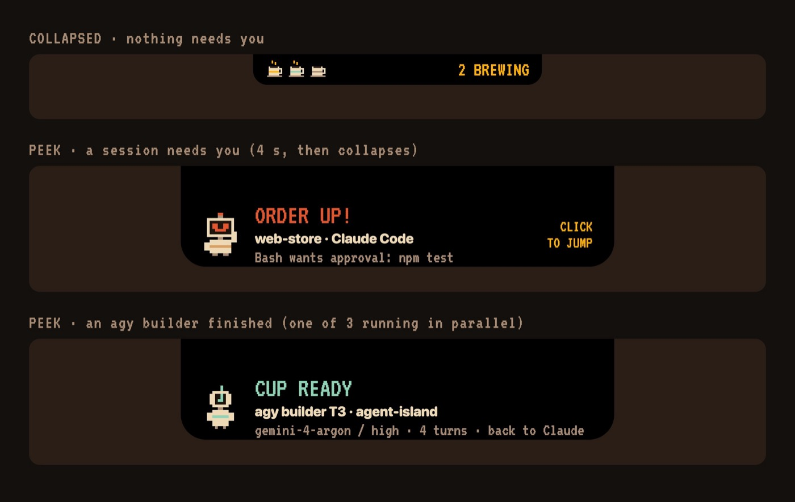
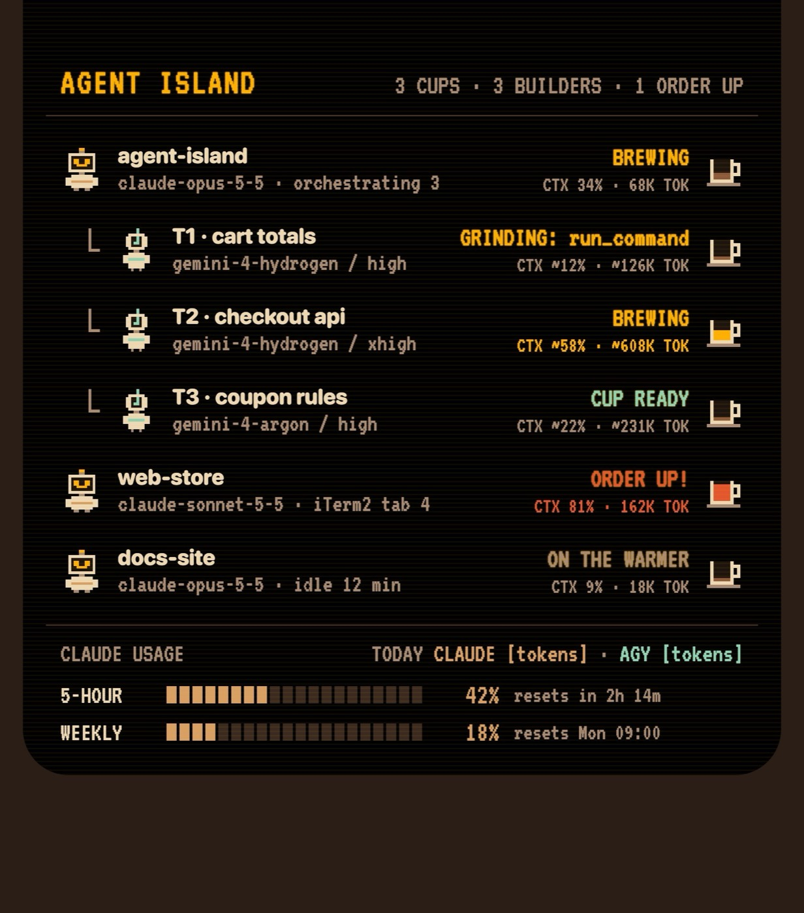
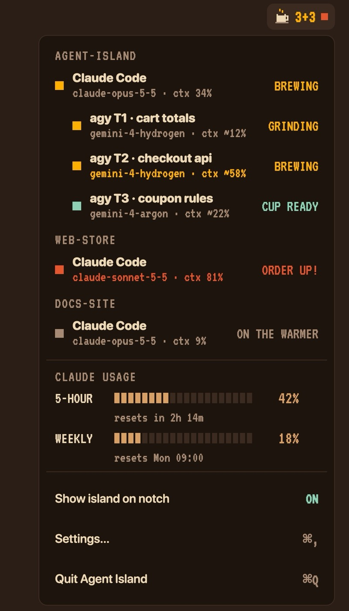
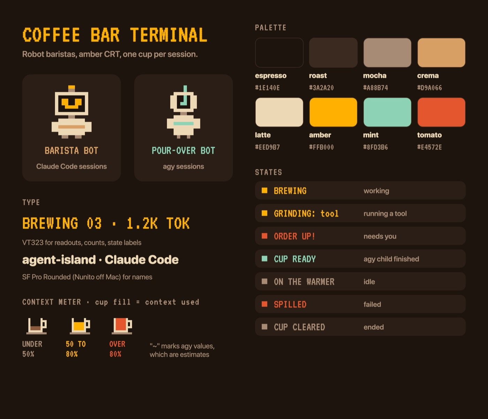

# Doppio

A macOS notch and menu bar app that shows your Claude Code and agy (Antigravity CLI) sessions as cups of coffee. Each session is a cup. It brews while the agent works, turns red when the agent needs you, and plays a short chord when Claude finishes.



## What it shows

The notch stays collapsed while nothing needs you. When a session asks for approval it peeks open for a few seconds, and clicking it jumps to that terminal tab. Expanded, it lists every session with its model, state, context use and tokens, with agy builders nested under the Claude session that started them, plus your Claude 5-hour and weekly usage.



The menu bar icon is a cup for Claude and a robot for agy. Each one animates while its agent is working. The dropdown has the same session list grouped by project.



The screenshots are design mockups from before the rename, so a few labels still say Agent Island.

## States

| Label | Meaning |
|---|---|
| BREWING | working |
| GRINDING: tool | running a tool |
| ORDER UP! | needs you |
| CUP READY | agy builder finished |
| ON THE WARMER | idle |
| SPILLED | failed |
| CUP CLEARED | ended |

The cup fills with context used: brown under 50%, amber from 50 to 80%, tomato above 80%. Values marked `~` come from agy and are estimates.



## Install

Needs macOS 14 or later on a Mac with a notch, Swift 6, `jq`, Claude Code and agy.

```bash
install/install.sh
```

```bash
install/bundle-app.sh
```

```bash
open build/Doppio.app
```

`install.sh` builds `island-bridge` and `cc-agy` into `~/.local/bin`, adds hooks to Claude Code and agy, installs the `agy-dispatch` skill and the builder agent, and appends a Roles section to `~/.claude/CLAUDE.md`. Each config it edits is backed up first. Pass `--strict` to also add a hook that blocks large source edits by Claude so the work goes to agy; set `CC_ROLE=solo` in a session to turn that off.

## How it works

    Claude Code / agy hooks
      → island-bridge (CLI)
        → Unix socket ~/Library/Application Support/Doppio/island.sock
          → Doppio.app SocketServer
            → SessionStore
              → notch view, menu bar label, daily totals

`cc-agy` runs agy builders in their own git worktrees and writes a run record for each, which Doppio reads for agy token totals.

## Tests

```bash
swift test
```
